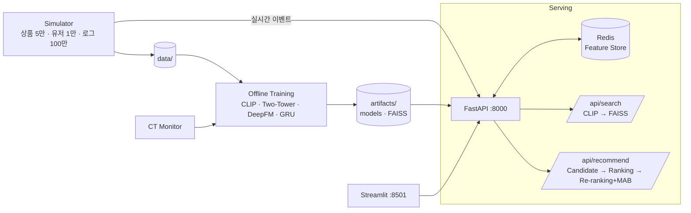

# Multimodal Search & Multi-Stage Recommender

> **2026-10-26 Stage 1/2 연결:** 팀 공유 데이터 v20261022로 Two-Tower → FAISS → DeepFM CVR 학습·추천 API 검증을 완료했습니다. [실행 방법 및 구현 설명](docs/stage12_integration.md) · [실측 결과](docs/stage12_team_result.md) · [구현 검토 보고서 PDF](docs/Stage12_CVR_구현검토보고서.pdf). 공유 데이터를 받은 경우 아래 전체 데이터 생성 절차 대신 안내 문서의 `run_stage12.ps1 -Action demo`를 사용하세요. 아래 전체 아키텍처에는 아직 구현되지 않은 서비스 기능도 포함되어 있습니다.


CLIP 기반 **멀티모달 검색**과 Two-Tower → DeepFM → Re-ranking(MAB) **Multi-Stage 추천**,
세션 기반 실시간 추천, A/B 테스트, Continuous Training까지 포함한 End-to-End 이커머스 시스템.

## 아키텍처



## 빠른 시작

```bash
cp .env.example .env
make install            # 로컬 개발 환경
./scripts/setup_all.sh  # 데이터 생성 → 분할 → 인덱스 → 학습 → 평가
docker compose up       # redis, api(:8000), dashboard(:8501), simulator
```

| 서비스 | 주소 |
|---|---|
| API docs | http://localhost:8000/docs |
| Dashboard | http://localhost:8501 |

## API

- `POST /api/search` — `query_text`, `image`, `top_k` → `search_type`, `results[]`, `latency_ms`, `total_count`
- `GET /api/recommend?user_id=U1234&top_n=10` → `user_id`, `recommendations[]`, `pipeline_latency`, `session_context`
- `POST /api/events` — 클릭 이벤트 수신 (Redis 실시간 피처 갱신)

응답 스키마: [`src/common/schemas.py`](src/common/schemas.py)

## 디렉토리 구조

```
configs/        설정 (하이퍼파라미터, 경로, 페르소나, 전략) — 코드 하드코딩 금지
data/           시뮬레이터 생성 데이터 (git 제외, make data 로 재생성)
artifacts/      모델 · FAISS 인덱스 (버전별, git 제외)
src/
  common/         공통 스키마 · 설정 로더 · 시드 · FAISS 유틸
  simulator/      고객 행동 시뮬레이터
  search/         CLIP 멀티모달 검색 + BM25 베이스라인
  recommendation/ candidate(Two-Tower) · ranking(DeepFM) · session(GRU) · reranking(MAB) · strategies
  serving/        FastAPI · Redis Feature Store
  evaluation/     metrics.py · 데이터 분할 · 평가 · latency 벤치마크
  abtest/         A/B 시뮬레이션 · 통계 검정
  ct/             모니터링 · 재학습 트리거 · 모델 레지스트리
dashboard/      Streamlit
docker/         Dockerfile (api / dashboard / simulator)
docs/           실험 리포트 · 아키텍처 · 팀 역할
```

## 목표 지표

| 영역 | 지표 | 목표 | 결과 |
|---|---|---|---|
| 검색 | MRR / NDCG@10 | ≥ 0.55 / ≥ 0.50 | |
| Candidate | Recall@300 | ≥ 0.30 | |
| Ranking | AUC | ≥ 0.70 | |
| 추천 | HitRate@50 / NDCG@50 / Coverage | ≥ 0.20 / ≥ 0.08 / ≥ 0.20 | |
| Latency (p95) | 검색 · 추천 / 후보 / 피처 | < 200ms / < 100ms / < 10ms | |

## 재현성

- `random_seed = 42` (시뮬레이터 · 분할 · 학습)
- 분할: train / valid / test = 8 / 1 / 1 (시간 기반)
- 상세: [docs/](docs/)

## 팀

[docs/team.md](docs/team.md)

## 브랜치 전략

- `main` (보호) ← `dev` ← `feat/<영역>-<내용>` (예: `feat/search-clip`, `feat/rec-two-tower`)
- PR 머지, 리뷰어는 `.github/CODEOWNERS` 로 자동 지정
- `src/common/schemas.py` 변경은 팀 전원 리뷰
