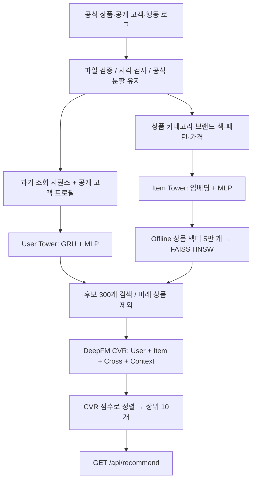

# 팀 공유 데이터 연결: Stage 1 · Stage 2 (CVR)

업데이트 저장소와 `multistage_data_v20261022`를 연결했다. H&M 상품 50,000개·가격, 가상 고객 10,000명, 시뮬레이터 행동 1,184,026건을 사용해 Two-Tower → FAISS → DeepFM CVR 학습과 추천 API 검증을 완료했다. **이번 결과는 팀 시뮬레이터 데이터에 대한 오프라인 검증이다.** 실제 구매자 로그를 사용한 서비스 성과나 온라인 구매율 향상은 아니다.

## 실행 위치와 빠른 실행

이 문서가 들어 있는 프로젝트 최상위 폴더가 새 통합본이다. 원본 Downloads 저장소와 전달받은 데이터는 수정하지 않았다.

현재 PC에서는 프로젝트 폴더에서 PowerShell로 실행한다.

```powershell
# 저장된 모델로 추천 API 요청·응답 검증 (추가 학습 없음)
.\run_stage12.ps1 -Action demo

# 원본 데이터 9개 파일의 SHA-256 확인
.\run_stage12.ps1 -Action verify

# 서버 실행: 이 창을 유지하고 브라우저에서 아래 주소 확인
.\run_stage12.ps1 -Action serve
```

서버 실행 후 주소:

- API 문서: http://127.0.0.1:8000/docs
- 추천 예제: http://127.0.0.1:8000/api/recommend?user_id=U00001&top_n=10&at=2026-03-24T00%3A00%3A00Z

다른 PC에서는 Python 환경을 만들고 `python -m pip install -r requirements/dev.txt`로 의존성을 설치한다. `run_stage12.ps1`은 현재 PC의 기존 실행 환경이 있으면 사용하고, 다른 PC에서는 `python` 명령을 사용한다. 직접 실행할 때는 다음과 같다.

```bash
python scripts/stage12_team.py --action verify
python scripts/stage12_team.py --action demo
python scripts/stage12_team.py --action evaluate
```

`demo`는 실제 FastAPI 앱을 TestClient로 호출한다. 검색 인덱스가 없어도 추천 모델만으로 동작한다. `serve`는 로컬 HTTP 서버를 실행한다. 검색 CLIP 모델/이미지 인덱스는 이번 추천 연결 범위에 포함하지 않는다.

## 재학습

현재 모델 폴더를 덮어쓰지 않도록 새 출력 폴더를 지정한다.

```bash
python scripts/stage12_team.py --action all --output artifacts/models/stage12-cvr-team-v2
```

위 명령은 체크섬 확인 → Two-Tower 학습 → 상품 벡터 사전 계산 및 FAISS 저장 → DeepFM CVR 학습 → 테스트 평가 → API 검증을 실행한다. 새 모델을 서버에서 사용하려면 `REC_MODEL_DIR`을 해당 폴더로 지정한다. 이미 학습된 폴더를 지정하면 덮어쓰기를 거부한다.

공유 파일이 이미 있으므로 `make data`, `make split`, `setup_all.sh`를 다시 실행할 필요가 없다. 원본 H&M 이미지, Retailrocket 원본, 숨김 페르소나 파일도 이번 추천 모델 학습에 필요하지 않다.

## 데이터 연결

| 입력 파일 | 사용 목적 |
|---|---|
| `data/processed/products.parquet` | 상품 ID, 3단계 카테고리, 브랜드·색·패턴, 실제 제공된 가격, 생성 시각 |
| `data/processed/users.parquet` | 사용자 ID, 연령대, 성별, 가입 시각 |
| `data/splits/train_events.parquet` | 학습 행동 및 CVR 정답 |
| `data/splits/valid_events.parquet` | 모델 선택용 검증; 테스트 시 과거 이력으로 사용 |
| `data/splits/test_events.parquet` | 최종 평가 정답만 사용 |
| `data/splits/meta.json` | 팀 공식 시간 구간과 분할 계약 |
| `data/splits/*_impressions.parquet` | 공유 파일 무결성 검사는 하지만 CVR 학습에는 사용하지 않음 |

공식 세션 분할을 재배정하지 않았다. Train: 1월 1일~3월 13일, Valid: 3월 14일~22일, Test: 3월 23일~31일. 원본 시각에 시간대가 없으므로 동일한 시계 기준을 유지하기 위해 UTC로 해석한다. API 재현 시에도 UTC 시각을 넣는다.

학습 조회의 사용자 피처는 그 조회보다 엄격하게 앞선 행동만 사용한다. Valid의 행동 이력은 3월 14일 이전 Train으로 고정한다. Test의 행동 이력은 3월 23일 이전 Train+Valid로 고정한다. Test 파일은 모델 학습, 모델 선택, 입력 행동 이력에 사용하지 않는다. 저장된 서빙 이력에도 Test 이벤트를 넣지 않는다.

## 추천 흐름



- Two-Tower는 다음 조회 상품을 맞히도록 학습한다. 사용자 타워는 최근 조회 20개와 공개 프로필·과거 행동 수를 사용한다. 상품 타워는 상품 ID 임베딩과 카테고리·속성·가격을 사용한다. 요청 시점에 등록된 상품에서 음성 상품 4개를 추출한다. 이것은 CTR 미클릭 정답을 만드는 작업이 아니다.
- FAISS에는 상품 벡터를 사전 계산하여 저장한다. 요청 시 User Tower와 인덱스 검색만 수행하고, 등록 전 상품은 제외한다.
- DeepFM은 사용자·상품·교차·시간 피처로 조회 조건부 구매 전환을 학습한다. 교차 피처는 과거 동일 상품/카테고리 조회 비율과 가격 차이이며 Context는 시간대와 요일이다.
- 최종 점수는 `P(24시간 이내 구매 전환 | 조회, 공개 피처)`에 대한 모델 추정이다. 노출당 CTR 또는 구매율이 아니며, 점수의 확률 보정은 별도로 검증하지 않았다.

## CVR 정답 정의

동일 사용자·동일 상품 구매를 **구매 시점보다 앞선 24시간 이내의 가장 최근 조회 1건**에 귀속한다. 조회와 구매는 같은 공식 분할에 있어야 한다. 해당 조회는 1, 구매가 귀속되지 않은 조회는 0이다. 분할 종료까지 24시간이 확보되지 않은 조회는 CVR 학습·평가에서 제외한다. 양성·음성 비율은 이 규칙과 제공된 로그에서 결정되며 임의 클릭률을 생성하지 않는다.

전체 구매 건수와 CVR 양성 수가 같을 필요는 없다. 조회 없이 발생한 구매, 관찰 기간이 부족한 조회, 같은 조회에 중복 귀속되는 구매 등의 영향이 있다. 모델의 AUC는 실제로 조회된 상품에서 평가하므로, 미조회 후보 상품까지의 구매 확률 정확도가 보장되는 것은 아니다.

## 데이터에서 발견한 문제와 처리

- 공식 파일 9개 모두 제공된 SHA-256과 일치했다.
- 가격은 상품 50,000개 모두 존재한다. 원본 제공 단위를 그대로 사용하며 통화 변환이나 임의 보정을 하지 않는다.
- 가입 전 행동 **386건 / 99명**을 발견했다. Train 333건, Valid 37건, Test 16건이다. 원본 수정 없이 학습·이력·평가에서 해당 행만 제외했다. 제외 목록은 모델 폴더의 `excluded_pre_signup_events.parquet`에 저장했다.
- 공식 분할은 세션 시작 시각 기준이어서 일부 Train/Valid 행동이 다음 구간으로 넘어간다. 분할 자체는 유지하고, 학습·검증 조회 중 경계를 넘은 42건만 예제에서 제외했다. 이력도 각 기준 시각 전으로 제한한다.
- 상품 등록 전 행동, 알 수 없는 상품/사용자, 중복 ID는 오류로 처리한다. 숨김 사용자 페르소나는 읽지 않는다.

## 코드 리뷰 순서

| 코드 | 구현 내용 |
|---|---|
| `src/recommendation/ranking/features.py` | 공식 분할 읽기, 공개 피처, 가입 전 기록 제외, 시점별 이력, 구매 귀속, Cross/Context |
| `src/recommendation/candidate/two_tower.py` | User GRU와 Item 타워 |
| `src/recommendation/training.py` | 두 모델 학습, 음성 샘플링, Valid 기반 체크포인트 선택, FAISS 생성 |
| `src/recommendation/candidate/retriever.py` | 시간 조건을 만족하는 후보 검색 |
| `src/recommendation/ranking/deepfm.py` | Linear + FM + MLP의 CVR 로짓 |
| `src/serving/model_loader.py` | 모델·상품 ID 매핑 검증 및 캐시 |
| `src/recommendation/pipeline.py` | 후보 300개 → CVR 정렬 → 응답 |
| `src/serving/routers/recommend.py` | 기존 API에 연결, 시간 검증, 모델 누락 오류 |
| `src/evaluation/eval_recommend.py` | 최종 Test Recall/AUC/지연 측정 |
| `scripts/stage12_team.py` | 무결성 검사·학습·평가·실제 API 검증 실행 |
| `tests/test_recommendation.py` | 시점 누수, 구매 귀속, 신규 상품, API, 재로딩 및 제외 규칙 검증 |

팀의 새로운 `src/evaluation/split.py`와 시뮬레이터 구현은 유지했다. 기존 `make train`에서 아직 미구현인 별도 Session Encoder 호출을 제거하여 Stage 1/2까지만 실행하도록 했다.

## 결과와 남은 범위

실측 결과는 [stage12_team_result.md](stage12_team_result.md), 원시 수치는 [stage12_team_metrics.json](stage12_team_metrics.json)을 참고한다.

이번 완료 범위는 **공식 공유 데이터 → 학습 → FAISS → CVR 정렬 → 기존 추천 API → 오프라인 평가**이다. CTR, Stage 3/MAB, 실시간 Redis 이력 갱신, 서비스 배포, 온라인 A/B 검증, GitHub 업로드는 포함하지 않았다. `/api/events`는 아직 기존 스텁이므로 새 클릭을 보내도 현재 추천 이력이 갱신되지 않는다. `at`을 생략하면 현재 시각으로 계산하지만 저장 이력은 고정되어 있으므로, 이 데이터의 데모는 명시적인 2026년 3월 테스트 시각을 권장한다.

GitHub에는 소스·설정·테스트·문서를 올리고, 약 90MB인 원본 데이터와 모델 산출물은 별도 공유한다. 기존 `.gitignore`가 `data/processed`, `data/splits`, `artifacts/models`를 제외한다. 코드 ZIP에는 대용량 데이터와 모델이 포함되지 않는다.
